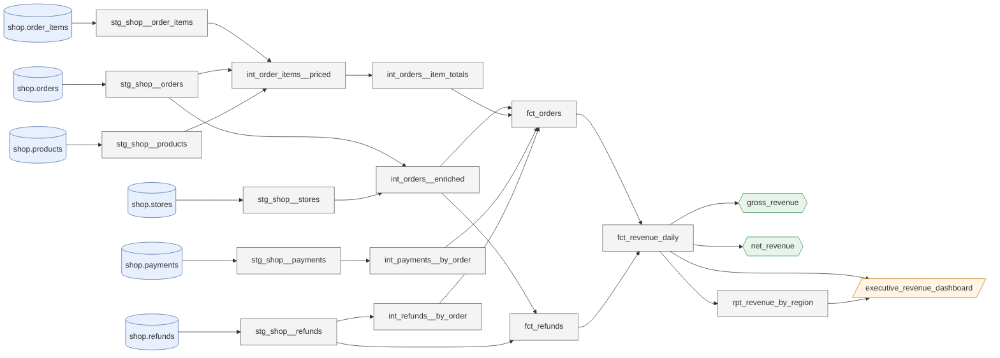

# warehouse-graph

Shared foundation for two linked projects:

- [`warehouse-qa`](https://github.com/Crestward/warehouse-qa): a governed, lineage-aware "ask your warehouse" assistant
- [`pipeline-sentinel`](https://github.com/Crestward/pipeline-sentinel): a tiered incident agent for data pipelines

This package will build a metadata/lineage graph from dbt artifacts, compile one `policies.yml` to database access controls (Postgres RLS / Unity Catalog), and serve the graph over an MCP server.

> **Status: Phase 3 (adapters, policy-as-code, MCP server).** Done so far:
> - repo tooling and the LLM wrapper (cost ledger, cache, budget cap, Batch API)
> - **Kiwi Retail Co.**, a deliberately messy synthetic warehouse: 40 dbt models, 13 metrics, 6 dashboards, 13 documented traps
> - **the metadata graph**: 575 nodes and 1,026 edges built from the dbt artifacts in ~10 s, with 97.8% column-level lineage and a Python query API
> - **governance**: one `policies.yml` compiled to Postgres roles, RLS, column grants and masked views; role-filtered metadata; a description lint; an append-only audit log; and the 5-tool **MCP server**

## Quick start

```bash
cp .env.example .env      # add ANTHROPIC_API_KEY for real model calls
uv sync
make warehouse            # Postgres + synthetic data + dbt build + artifacts (~1 min)
make graph                # make warehouse, then build the graph file (build/graph.wgz)
make policies             # make graph, then lint + apply policies.yml (rerun after any dbt build)
make demo                 # make policies, then the Dagster UI at http://localhost:3000
make check                # lint, format check, type-check, tests
```

## The demo warehouse: Kiwi Retail Co.
A fictional NZ/AU retailer: 12 stores (2 online), 9,000 customers, ~29k orders from Jan 2024 to Sep 2026, in NZD and AUD.

```
raw.* (11 tables, seeded generator)
  └─ staging (11 views) ─ intermediate (9 views) ─ marts (20 tables)
                                                    ├─ core: customers, products, stores, employees, orders, items, payments, refunds
                                                    ├─ finance: fct_revenue_daily (canonical revenue), rpt_revenue_by_region
                                                    ├─ marketing: campaigns, ad spend, campaign performance
                                                    ├─ customers: churn, LTV, active customers
                                                    └─ legacy: orders_v1 (deprecated), rpt_regional_sales_legacy (fan-out)
```

| Piece | Where |
|---|---|
| Generator and loader | `src/warehouse_graph/demo/` (`warehouse-graph demo-data [--stale TABLE]`) |
| dbt project (models, tests, freshness, exposures, Semantic Layer metrics) | `demo/kiwi_retail/` |
| Tribal knowledge attached to nodes | `demo/caveats.yml` (15 caveats, one a planted injection) |
| Validated question → SQL examples | `demo/query_examples.yml` (30, each tested against the DB) |
| Orchestration (nightly `dbt build`, run-failure sensor) | `demo/orchestration/definitions.py` (Dagster) |
| Artifacts for the graph | `demo/artifacts/` (`manifest`, `catalog`, `run_results`, `sources`), produced by `make warehouse` |
| Planted traps and their measured effects | [`docs/planted-traps.md`](docs/planted-traps.md) |

## The metadata graph
`warehouse-graph build` turns the four dbt artifacts, `caveats.yml` and `query_examples.yml` into one versioned file, `build/graph.wgz`. It holds a NetworkX graph, a local sentence-transformer embedding per node, and the manifest hash. It loads into memory in under a second and needs no database.

| Nodes | Edges |
|---|---|
| `source` · `model` · `column` · `metric` · `exposure` · `caveat` · `query_example` | `DEPENDS_ON` · `HAS_COLUMN` · `COLUMN_DERIVES_FROM` (sqlglot) · `DEFINES` · `EXPOSES` · `HAS_CAVEAT` · `ANSWERED_BY` |

Every node carries the governance metadata later phases need: owner, deprecation + replacement, planted-trap flags, and PII/sensitivity tags, which spread along pass-through column lineage down to the raw tables. Counts and lineage coverage are in [`docs/graph-stats.md`](docs/graph-stats.md).

```python
from pathlib import Path
from warehouse_graph.graph import GraphArtifact, GraphQuery

q = GraphQuery(GraphArtifact.load(Path("build/graph.wgz")))
q.search_nodes("churn rate", k=5)  # hybrid BM25 + vector, reciprocal-rank fused
q.get_node("model.orders_v1")  # record + caveats + columns (deprecated -> fct_orders)
q.get_lineage("column.fct_revenue_daily.net_revenue_nzd", "upstream", depth=10, level="column")
q.get_blast_radius("source.shop.orders")  # downstream models, dashboards, metrics by criticality
q.get_metric("revenue")  # definition + SQL; canonical_alternative = net_revenue
```
These five operations become the five MCP tools in Phase 3.

Lineage of the canonical revenue model (`warehouse-graph lineage model.fct_revenue_daily --direction both`):



## Governance: one policy file, enforced by the database
**The LLM is never the enforcement point.** [`policies.yml`](policies.yml) defines six principals: `admin`, `finance`, `marketing`, `analyst_au`, `analyst_nz` and the `sentinel` service principal. For each, it sets the schemas they may use, a row filter, and **hidden** or **masked** columns, selected by the graph's PII tags (`pii:email`, `sensitivity:restricted`, ...).

`warehouse-graph policies` resolves that file against the graph, refuses to continue if any visible description mentions a hidden column, and compiles it to Postgres:

| Control | How |
|---|---|
| Identity | one LOGIN role per principal: NOINHERIT, read-only, 30 s statement timeout, so no `SET ROLE` escalation |
| Rows | RLS on the tables behind `marts`, keyed on `current_user` (`analyst_au` sees `region_code = 'AU'` only) |
| Hidden columns | never granted (column-level grants), and removed from the principal's metadata |
| Masked columns | `security_barrier` views in `marts` (`a***@***.com`, `***-***-199`, `A***`) |
| Metadata | each principal gets its own filtered graph; a hidden id is "not found", exactly like a made-up one |
| Audit | `audit.events`, append-only by trigger; `audit_writer` can only insert |

The SQL is the same for every role (`select email from marts.dim_customers`); the database decides what comes back. Design: D13-D15 in [`docs/design-decisions.md`](docs/design-decisions.md).

## MCP server
Both projects reach the graph only through these five tools, always as the caller's principal:

| Tool | Returns |
|---|---|
| `search_nodes(query, types?, k)` | hybrid-ranked nodes with scores, trap and deprecation flags |
| `get_node(id)` | full record including caveats and columns |
| `get_lineage(id, direction, depth, level)` | subgraph at model or column level |
| `get_blast_radius(id)` | downstream models, dashboards and metrics, ranked by criticality |
| `get_metric(name)` | definition, canonical SQL and the canonical alternative |

```bash
uv run warehouse-graph mcp --identity analyst.au@kiwiretail.example   # stdio; add --audit to log calls
```
Input and output schemas are pinned in [`schemas/mcp/v1/`](schemas/mcp/v1/). **Prior art:** dbt Labs ships an official [`dbt-mcp`](https://github.com/dbt-labs/dbt-mcp) server (lineage, Semantic Layer, text-to-SQL). This one differs in three ways: caveat and trap nodes, metadata filtered per role by the same policy the database enforces, and the eval harness built on top of it (Phases 4-8).

## Docs
- [`docs/design-decisions.md`](docs/design-decisions.md): decisions and why
- [`docs/planted-traps.md`](docs/planted-traps.md): the 13 traps the evals are built around
- [`docs/graph-stats.md`](docs/graph-stats.md): node/edge counts and column-lineage coverage
- [`docs/parking-lot.md`](docs/parking-lot.md): ideas deliberately left out of v1

## Licence
MIT. See [LICENSE](LICENSE).
